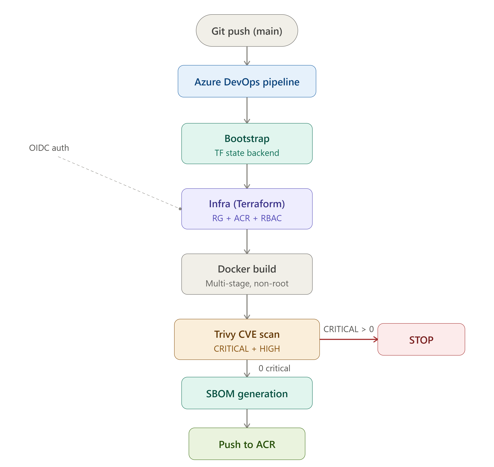
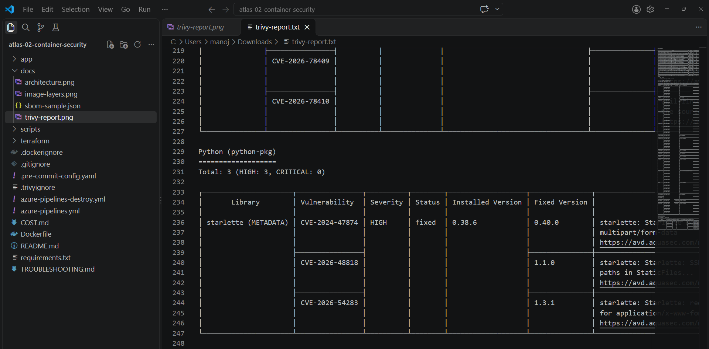
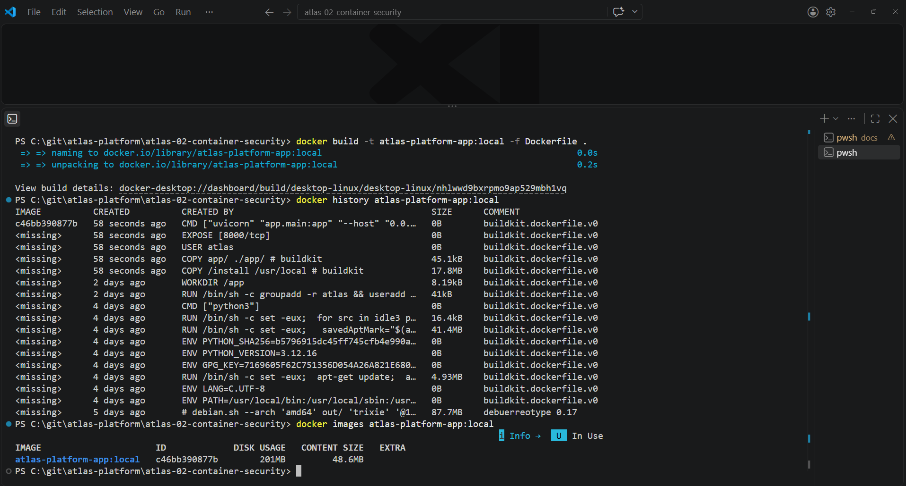

# atlas-02-container-security

Container security and image hardening for the Atlas Platform portfolio. Builds a production-grade Docker image of a Python FastAPI app, scans it for CVEs, generates an SBOM, and pushes to Azure Container Registry **only if the scan is clean**. Fully ephemeral: created and destroyed by pipeline in one day.

**Part of the [Atlas Platform Portfolio](https://github.com/manoj-2606): 11 production-grade Azure DevOps projects.**

---

## What This Project Proves

1. **Multi-stage Docker build** — builder installs dependencies, production stage copies only the result. Final image under 100MB.
2. **Non-root container** — app runs as user `atlas` (no shell, no home).
3. **CVE gate** — Trivy scans the local image before any push. One CRITICAL CVE fails the pipeline and ACR never sees the image.
4. **SBOM** — every image ships with an SPDX JSON bill of materials.
5. **Zero stored credentials** — OIDC workload identity federation for Terraform and `az acr login`. ACR admin user disabled.
6. **Full teardown** — destroy pipeline removes the project RG **and** the Terraform backend RG. Zero cost overnight.

---

## Architecture



Flow:

```
Bootstrap (backend RG + storage)
   → Infra (Terraform: RG + ACR + AcrPush role)
   → Container_Security:
        docker build → Trivy scan (gate) → SBOM → az acr login + docker push → verify → publish artifacts
```

---

## Evidence

**Trivy scan — zero CRITICAL CVEs, image allowed to proceed:**



**Image layers and final size (multi-stage, under 100MB):**



**Image in ACR — build-ID tag and `latest` point to the same digest (one manifest):**


**SBOM sample (SPDX JSON):** [docs/sbom-sample.json](docs/sbom-sample.json)

---

## Pipeline Stages

| Stage | What happens | Execution style |
|---|---|---|
| Bootstrap | Idempotently creates backend RG, storage account, container | AzureCLI@2 (bash) |
| Infra | Installs Terraform (pinned 1.9.8), init, plan, apply: RG + ACR + AcrPush | AzureCLI@2 + OIDC env vars |
| Container_Security | `docker build -t`, Trivy scan, SBOM, push, verify, publish reports | bash scripts, AzureCLI@2, PublishPipelineArtifact@1 |

**Destroy pipeline** (`azure-pipelines-destroy.yml`): `terraform destroy` first (needs state), then deletes the backend RG, then verifies both RGs are gone.

**Versus P1:** P1 was Terraform-heavy with PowerShell validation. P2 is Docker-heavy: security gates, scan report parsing, `az acr` verification, artifact publishing.

---

## Security Controls

| Control | Implementation | Why |
|---|---|---|
| Non-root user | `USER atlas` | Compromised container cannot escalate to root |
| Multi-stage build | Builder discarded | No pip, cache, or build tools in final image |
| CVE gate | `scripts/scan-trivy.sh` parses JSON, exits 1 on CRITICAL | Dirty images never reach the registry |
| Documented exceptions | `.trivyignore` with justification per CVE | Accepted risk is an engineering decision, not silence |
| SBOM | `scripts/generate-sbom.sh` (SPDX JSON) | Supply chain visibility; grep for a zero-day in minutes |
| No stored credentials | OIDC (5 `ARM_*` env vars) | Token exchange replaces secrets |
| ACR admin disabled | `admin_enabled = false` | Identity-based access only |
| Secrets scanning | gitleaks pre-commit | Secrets never reach Git history |
| Layer caching | `requirements.txt` copied before `app/` | App edits do not rebuild the dependency layer |

---

## Dockerfile

```dockerfile
FROM python:3.12-slim AS builder
WORKDIR /build
COPY requirements.txt .
RUN pip install --no-cache-dir --timeout=120 --retries=10 --prefix=/install -r requirements.txt

FROM python:3.12-slim
RUN groupadd -r atlas && useradd -r -g atlas -d /app -s /sbin/nologin atlas
WORKDIR /app
COPY --from=builder /install /usr/local
COPY app/ ./app/
USER atlas
EXPOSE 8000
CMD ["uvicorn", "app.main:app", "--host", "0.0.0.0", "--port", "8000"]
```

The Dockerfile reads only from the **build context** (this repo, checked out on the agent). App source is vendored into `app/` and `requirements.txt` at the repo root. Later projects (P3+) consume `atlas-platform-app` by repository reference instead.

---

## What is an SBOM?

A list of every package inside the image, like an ingredients label. When a new CVE drops, search SBOMs instead of re-scanning every image. Generated with `trivy image --format spdx-json`.

---

## Prerequisites

1. Azure Pay-As-You-Go subscription
2. ADO project `Atlas-Platform`, service connection `MI-ADO-API` (OIDC) with Contributor on the subscription (needed to delete the backend RG)
3. Variable group `atlas-02-vars`: `serviceConnection`, `backendResourceGroup`, `backendStorageAccount`, `backendContainer`, `backendKey` (`atlas-02.tfstate`), `location`
4. ADO environments: `atlas-02-deploy`, `atlas-02-destroy` (approval checks)

## Deploy

1. Push to ADO repo `atlas-02-container-security`
2. Create pipeline from `azure-pipelines.yml`
3. Run, approve the deploy environment gate
4. Download the `security-reports` artifact (Trivy report + `sbom.json`)

## Cleanup

Run the destroy pipeline and approve `atlas-02-destroy`. It removes `rg-atlas-02-dev` and the backend RG, then verifies both are gone.

Manual fallback:

```bash
az group delete --name rg-atlas-02-dev --yes
az group delete --name rg-atlas-tfstate --yes
```

Verify: Azure Portal → Resource Groups → search `atlas` → empty.

**Do not run P2 destroy while another project's state still lives in the shared backend RG.**

---

## Cost

~₹15 per project day (ACR Basic only, no AKS). Breakdown: [COST.md](COST.md)

---

## Lessons Learned (real failures from the first run)

| # | Failure | Root cause | Prevention |
|---|---|---|---|
| 1 | `terraform: command not found` | Hosted agent has no Terraform | Install pinned Terraform in every pipeline |
| 2 | `$(terraformVersion)` not found | Variable never defined in the group | Hardcode tool versions in YAML |
| 3 | `Authenticating using Azure CLI is only supported as a User` | `ARM_OIDC_TOKEN` not exported | Export all 5 OIDC env vars, copy from a working pipeline |
| 4 | PyPI SSL/timeout in `docker build` | Hosted-agent network flakiness | `pip --timeout=120 --retries=10` |
| 5 | Trivy install timed out | GitHub releases unreachable from agent | Fallback install via apt repo |
| 6 | `unable to find image "atlas-platform-app:311"` | `Docker@2` without `repository` does not apply tags | Plain `docker build -t` |
| 7 | YAML error after switching task to script | Orphaned `inputs:` block | Delete the whole task block when replacing |

Full diagnosis and fixes: [TROUBLESHOOTING.md](TROUBLESHOOTING.md)

---

## Repo Structure

```
atlas-02-container-security/
├── terraform/
│   ├── main.tf                # RG + ACR + AcrPush role assignment
│   ├── variables.tf
│   ├── outputs.tf
│   ├── backend.tf
│   └── environments/dev.tfvars
├── app/
│   ├── __init__.py
│   ├── main.py
│   ├── metrics.py
│   └── simulator.py
├── scripts/
│   ├── scan-trivy.sh          # CVE scan, exits 1 on CRITICAL
│   └── generate-sbom.sh       # SPDX JSON SBOM
├── docs/
│   ├── architecture.png
│   ├── trivy-report.png
│   ├── image-layers.png
│   ├── acr-tags.png
│   └── sbom-sample.json
├── requirements.txt
├── Dockerfile
├── .dockerignore
├── .trivyignore
├── .pre-commit-config.yaml
├── .gitignore
├── azure-pipelines.yml
├── azure-pipelines-destroy.yml
├── COST.md
├── TROUBLESHOOTING.md
└── README.md
```

---

## Interview Summary

> Every image is scanned before it reaches a registry; one CRITICAL CVE stops the pipeline.
> Containers run as non-root, every image has an SBOM, and pipelines authenticate by OIDC with zero stored credentials.
> The whole environment, including the Terraform backend, is created and destroyed by pipeline in a day.

---

**Manoj Kumar R** — Senior DevOps / Platform Engineer
[GitHub](https://github.com/manoj-2606) · [LinkedIn](https://linkedin.com/in/manoj2606)